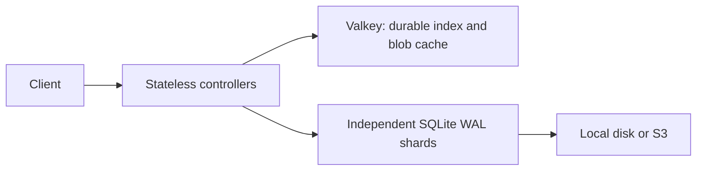

# scn

A centralized source control system in Rust, inspired by [Scion](https://www.anthropic.com/engineering/redesigning-source-control). Small clients, server-side commits, sparse working copies, and Zstandard compressed, content-addressed blobs.

## Architecture



- `scn shard` stores file deltas and commit metadata in SQLite, plus blobs on disk or S3. Shards do not communicate with each other.
- `scn cache` runs Valkey with AOF, RDB snapshots, configurable `maxmemory`, and `volatile-lru`. Requires `valkey-server` installed.
- `scn shard controller` provides the source control API. Run multiple controllers against the same Valkey namespace. Controllers keep no local durable state.

Paths get permanent shard assignments through atomic Valkey scripts. New paths go to the shard with the fewest assigned paths, including historical paths. Adding a shard never moves existing paths. Commit and blob locations are indexed separately, allowing shared blobs to be deduplicated. File deltas are stored on their assigned shards before a commit header is published.

Index keys and `main` have no TTL. Only cached compressed blobs expire or can be evicted. Push updates `main` atomically after checking ancestry. Valkey is authoritative storage for the index, so back it up alongside shard databases and blobs. AOF defaults to `appendfsync always`; `--appendfsync everysec` trades durability for throughput.

## Run locally

```sh
cargo install --path .
scn serve --store /tmp/scn-store
```

`serve` is the standalone option: one process, SQLite, and local blobs. In another terminal:

```sh
scn clone http://127.0.0.1:7878 /tmp/work
cd /tmp/work
printf 'hello\n' > hello.txt
scn add .
scn commit -m "Add greeting"
scn push
```

## Run with shards

Run each command in its own terminal:

```sh
scn cache --dir /data/cache --maxmemory 1gb
scn shard --store /data/shard-a --listen 127.0.0.1:7879
scn shard --store /data/shard-b --listen 127.0.0.1:7880
scn shard controller --cache redis://127.0.0.1:6379/ --shard http://127.0.0.1:7879 --shard http://127.0.0.1:7880
```

Clients connect to the controller on port 7878. Another controller can use the same `--cache` and `--namespace`, without repeating `--shard`. Set `--blob-ttl` in seconds to change the default 3600-second blob cache lifetime. Register a new shard by supplying its URL to any controller at startup. All controllers then use it for new assignments. Shard URLs must remain stable; removing or replacing a registered shard is not supported.

Use separate shard directories and a separate Valkey namespace for each repository. Internal shard APIs and Valkey should be reachable only by trusted services. Authentication and automated failover are not implemented. Large history queries still walk the commit graph directly.

## S3 blobs

Supply standard AWS credentials through environment variables, an AWS profile, or an instance role. The bucket must already exist:

```sh
scn shard --store /data/shard-a --s3-bucket my-bucket --s3-region eu-west-1 --s3-prefix my-repo/blobs
```

The same flags work with `serve`. Use `--s3-endpoint http://localhost:9000` for an S3-compatible service. Shards may share a bucket and prefix within one repository. SQLite stays on each shard; compressed blobs live in S3. Changing backends does not copy existing blobs.

## Git-style workflow

```sh
scn status
scn add path/to/file
scn diff --cached
scn commit -m "Describe the change"
scn push
scn fetch
scn pull
```

`add` snapshots contents, so later edits remain unstaged. `commit -a` stages modified and deleted tracked files. `diff` shows unstaged tracked changes; `diff --cached` shows staged changes. `.gitignore` and `.scnignore` both work. Set `SCN_AUTHOR` or use `commit --author` for your identity.

Commits are created on the server immediately. `push` advances `main` to your current commit; `land` is an alias. `fetch` updates `origin/main` without touching working files. `pull` fetches and merges; use `pull --rebase` to replay your commits or `pull --ff-only` to reject divergence. Push works with uncommitted edits. Pull and checkout require a clean working copy.

`log`, `show`, `blame`, `merge`, `rebase`, `checkout`, and `switch` are available. This MVP has one shared branch, `main`. Revisions accept `HEAD`, `main`, `origin/main`, or a full scn ID. There is no Git wire protocol or offline commit support.

Use `clone --sparse src` or `checkout main --sparse src` for selected paths. Repeat `--sparse` for more paths; `checkout main --full` restores the full tree. Commits preserve omitted files. Files are limited to 32 MiB. Merges report conflicts per file.

## Import Git history

With an empty `main`:

```sh
scn import-git /path/to/git-repo http://127.0.0.1:7878 --rev main
```

Imports all reachable commits, author identities and timestamps, messages, empty commits, and merge parents. Original Git IDs are retained and mapped to scn IDs. `main` advances only after import succeeds. Bare repositories work; uncommitted changes are untouched. Branch and tag refs are not copied. Shallow histories, symlinks, submodules, and merges with more than two parents are unsupported. Metadata and paths must be UTF-8.

New blobs use Zstandard. Existing zlib blobs and client caches are upgraded when read.

## Development

```sh
cargo test
cargo clippy --all-targets -- -D warnings
cargo fmt --check
SCN_VALKEY_SERVER=valkey-server cargo test --test cluster -- --ignored
```

Cluster tests use real Valkey processes, multiple controllers and shards, restart persistence, cache eviction, and concurrent writes. S3 tests use a local signed-request fixture.
