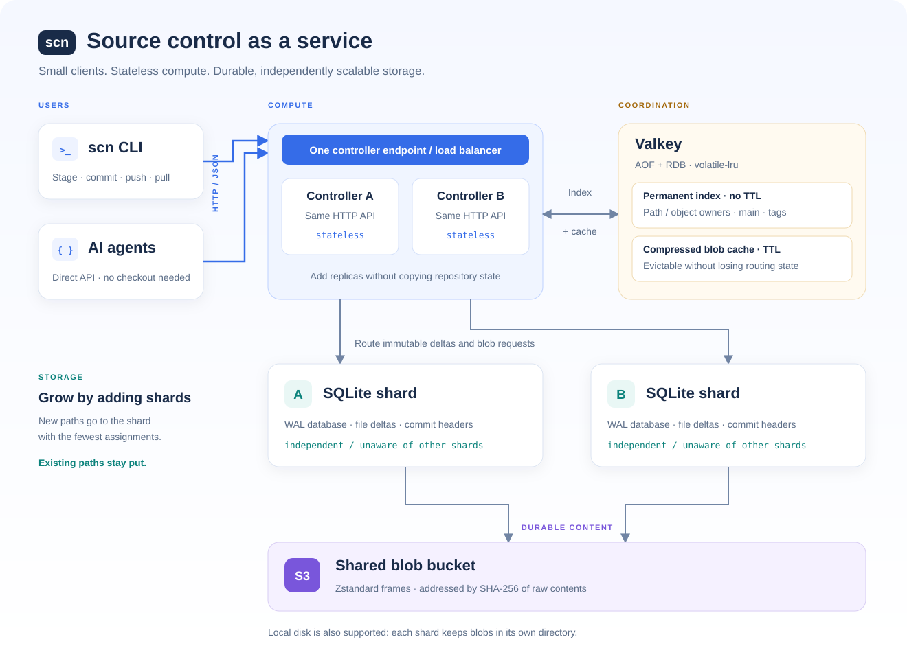

# scn

A centralized source control system in Rust, inspired by [Scion](https://www.anthropic.com/engineering/redesigning-source-control). Git-style CLI commands and an HTTP API for agents, with server-side commits, sparse checkouts, and Zstandard compressed blobs.

## Architecture



- **Controllers** run commits, history queries, diff, blame, merge, and rebase. Multiple controllers share one repository without local durable state. Each keeps a bounded, disposable cache of reconstructed trees.
- **Valkey** holds permanent shard assignments and `main`, plus compressed blobs with a configurable TTL. AOF and RDB persist the index; `volatile-lru` evicts only expiring cache entries.
- **Shards** store immutable file deltas and commit headers in independent SQLite WAL databases. New paths go to the shard with the fewest assignments. Existing paths never move.
- **Blob storage** is local disk per shard or a shared S3 bucket. IDs are SHA-256 hashes of raw contents. Stored and downloaded blobs use Zstandard only.

`commit` creates an immutable changeset on the server. `push` separately advances `main` with compare-and-swap. Agents can do both entirely through the API, without a checkout. See [AGENTS.md](AGENTS.md) for the client and API guide.

## Local cluster with Docker Compose

Requires Docker with Compose. From this repository:

```sh
docker compose up --build -d --wait
docker compose ps
curl --fail http://127.0.0.1:7878/health
```

[compose.yaml](compose.yaml) starts two controllers behind an Nginx gateway, two SQLite shards, persistent Valkey, and [RustFS](https://docs.rustfs.com/en/installation/container/docker), an S3-compatible store. An initialization job creates the `scn` bucket before shards start.

| Endpoint | Purpose |
| --- | --- |
| `http://127.0.0.1:7878` | CLI and controller API, balanced across both controllers |
| `http://127.0.0.1:9000` | Local S3 API |
| `http://127.0.0.1:9001` | S3 web console |

Local S3 credentials default to `SCNLOCAL` / `scn-local-secret-change-me`. Override them with `SCN_S3_ACCESS_KEY` and `SCN_S3_SECRET_KEY` before starting the stack. `SCN_CACHE_MEMORY` sets Valkey's memory limit, default `256mb`. Only the gateway and S3 ports are published, bound to loopback.

Each shard has its own volume. Valkey and S3 also have persistent volumes. Inspect or stop the stack with:

```sh
docker compose logs -f controller-a shard-a
docker compose down
```

`down` keeps data. `docker compose down -v` deletes the repository, index, and blobs.

## Point the CLI at a controller

Install the CLI and clone through the gateway or your existing controller:

```sh
cargo install --path . --locked
scn clone http://127.0.0.1:7878 ./work
cd work
scn remote -v
scn remote get-url origin
```

The clone saves the endpoint in `.scn/state.json`. Later commands use it automatically. To select another controller for the same repository:

```sh
scn remote set-url origin https://scn.example.com
scn fetch
```

Changing the endpoint preserves staged changes and working files, and clears the cached `origin/main` value. There is one remote, `origin`, and one shared branch, `main`.

## Git-style workflow

```sh
printf 'hello\n' > hello.txt
scn status
scn add hello.txt
scn diff --cached
scn commit -m "Add greeting"
scn push origin main
scn log -n 5
scn show HEAD hello.txt
```

`add` snapshots contents. Later edits stay unstaged. `commit -am "Update tracked files"` stages modifications and deletions of tracked files. `diff` shows unstaged tracked changes; `diff --cached` shows staged changes. `.gitignore` and `.scnignore` both work. Set `SCN_AUTHOR` or pass `commit --author` for your identity.

Synchronize with other clients:

```sh
scn fetch
scn log origin/main -n 5
scn pull --ff-only
```

`fetch` updates `origin/main` without changing files. `pull` fetches and merges. If histories diverge, use `scn pull --rebase` to replay your commits, then `scn push`. Push works with uncommitted edits; pull and checkout require a clean working copy. File conflicts leave working files unchanged.

For sparse working copies:

```sh
scn clone http://127.0.0.1:7878 ./agent-work --sparse src --sparse Cargo.toml
cd agent-work
scn checkout main --sparse docs
scn checkout main --full
```

Commits preserve omitted files. Revisions accept `HEAD`, `main`, `origin/main`, or a full scn ID. `checkout` has a `switch` alias; `push` has a `land` alias. There is no Git wire protocol or offline commit support.

## Run a cluster without Docker

Install Rust, Git, and `valkey-server`, then run `cargo install --path . --locked`. Run each server command in its own terminal, in this order:

```sh
scn cache --dir /tmp/scn-cache --listen 127.0.0.1:6379 --maxmemory 1gb
scn shard --store /tmp/scn-shard-a --listen 127.0.0.1:7879
scn shard --store /tmp/scn-shard-b --listen 127.0.0.1:7880
scn shard controller --listen 127.0.0.1:7878 --cache redis://127.0.0.1:6379/ --namespace demo --shard http://127.0.0.1:7879 --shard http://127.0.0.1:7880
```

These commands use local blob storage. A second controller can discover registered shards from Valkey:

```sh
scn shard controller --listen 127.0.0.1:7881 --cache redis://127.0.0.1:6379/ --namespace demo --blob-ttl 600
```

Clients can use either controller, or a load balancer in front of them. Register another running shard by passing its URL with `--shard` when starting any controller. All controllers then allocate new paths to it without rebalancing. Shard URLs must remain stable; shard removal is not supported.

For a single process without Valkey, use `scn serve --store /tmp/scn-store`.

## Use an existing S3 bucket

The bucket must exist. Supply AWS credentials through environment variables, an AWS profile, or an instance role. Start each shard with its own SQLite directory and a shared bucket/prefix:

```sh
scn shard --store /data/shard-a --listen 0.0.0.0:7879 --s3-bucket my-bucket --s3-region eu-west-1 --s3-prefix my-repo/blobs
```

For S3-compatible services, also pass `--s3-endpoint http://s3-host:9000`. The same storage flags work with `serve`. Changing backends does not copy blobs.

Use a separate Valkey namespace, shard directories, and bucket prefix per repository. Valkey is authoritative routing storage: back it up with the shard databases and blob store. `scn cache` defaults to `appendfsync always`; `--appendfsync everysec` trades durability for throughput. This MVP has no authentication or automatic failover. Uncached tree queries still replay first-parent history; ancestry queries read commit metadata without loading file deltas.

## Import Git history

With an empty `main`:

```sh
scn import-git /path/to/git-repo http://127.0.0.1:7878 --rev main
```

Imports reachable commits, authors and timestamps, messages, empty commits, and merge parents. Original Git IDs are retained; `main` advances only after success. Bare repositories work and uncommitted files are untouched. Branch and tag refs are not copied.

Files are limited to 32 MiB. Paths and commit metadata must be UTF-8. Symlinks, submodules, shallow imports, and merges with more than two parents are unsupported.

## Development

```sh
cargo test
cargo clippy --all-targets -- -D warnings
cargo fmt --check
SCN_VALKEY_SERVER=valkey-server cargo test --test cluster -- --ignored
docker compose config --quiet
cargo run --release --example perf -- 500
```

Cluster tests use real Valkey processes, multiple controllers and shards, restart persistence, eviction, and concurrent writes. S3 tests use a local signed-request fixture.

The local performance example accepts a total commit count (default 500). It measures sequential commits, warm tree reads, direct-parent checks, and 1 MiB blob reads. Cluster throughput also depends on network latency and Valkey persistence settings.
